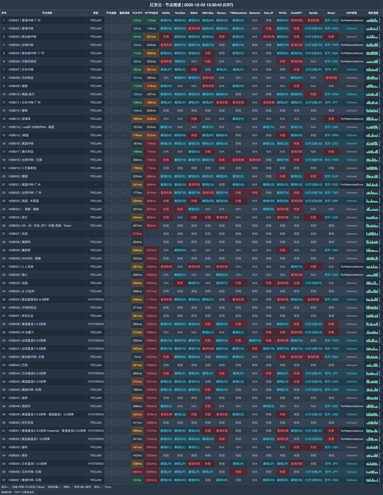

# 红杏云机场｜20 元/月 200G，家庭月付最高 1200G（2026-11-09 更新）

> **一句话结论：家庭大流量路线清楚：四档月付不限设备，另有 3000G 与 6000G 总量包**
>
> 👉 **[官网注册](https://hongxingdl.one/web/#/login?code=jxeAiWEC)** · 普通家庭先从 20 元 200G 起步，重度用量再升 60 元 800G。

### 以下家庭更容易选中：

- 成员多、设备多，需要共同使用
- 每月用量落在 200G—1200G
- 想把 3000G 不限时包作为备选

### 如果你要求这些，建议跳过：

- 必须看到下载速度数据再决定
- 购买后仍保留退款选项

| 选购项 | 结论 |
|---|---|
| 最低月付 | 20 元 / 200G |
| 月付范围 | 200G—1200G |
| 速度档位 | 300—1000Mbps |
| 设备规则 | 月付与 3000G 档不限；6000G 档 20 台 |
| 线路 | IEPL |
| 月付附带 | 赠送 EMBY |

**认识一下这家机场**：红杏云（Hongxing）面向家庭大流量场景，20 元 200G 起，月付档不限家庭设备并赠送 EMBY；另有用完为止的总量包。

## 全部套餐怎么卖

| 套餐名称 | 费用 | 流量与周期 | 设备数 | 速度 | 购买须知 |
|---|---:|---:|---:|---:|---|
| 轻量-包月200G | ¥20/月付 | 200G / 每月 | 不限 | 300M | 可购买重置包，家庭共享，赠送EMBY |
| 冲浪-包月500G | ¥40/月付 | 500G / 每月 | 不限 | 500M | 可购买重置包，家庭共享，赠送EMBY |
| 豪华-包月800G | ¥60/月付 | 800G / 每月 | 不限 | 800M | 可购买重置包，家庭共享，赠送EMBY |
| 大师-包月1200G | ¥80/月付 | 1200G / 每月 | 不限 | 1000M | 可购买重置包，家庭共享，赠送EMBY |
| 高级-不限时3000G | ¥388/一次性 | 3000G / 用完为止 | 不限 | 1000M | 可购买重置包，家庭共享 |
| 豪华-不限时6000G | ¥688/一次性 | 6000G / 用完为止 | 20 | 1000M | 可购买重置包 |

> 现有香港中转记录只有 TLS RTT 27ms 与 HTTPS 115ms，没有下载速度。所有套餐无退款；6000G 档写明 20 台，但没有写家庭共享范围。

## 节点测速一览

测试收录 **57 个节点**，内容覆盖延迟与解锁；测试端为 **华南-中山电信 [1Gbps]**，逐行结果放在下图。

## 月付和总量包怎么分

1. 轻度家庭从 20 元 200G 开始，速度档位为 300Mbps。
2. 每月接近 800G 时，60 元档比反复买重置包更直观，对应 800Mbps。
3. 不想月月续费可选 388 元 3000G；6000G 档的共享范围先问清再买。

## 从这里注册

👉 **[官网注册](https://hongxingdl.one/web/#/login?code=jxeAiWEC)** · 普通家庭先从 20 元 200G 起步，重度用量再升 60 元 800G。

*本文含推广链接；通过本文入口注册或购买，本站可能获得佣金。*

## 本文更新记录

- **2026-11-09** — 每日复核：套餐、价格与公告无变化；多账号发布对齐核查完成。
- **2026-11-08** — 每日复核：套餐、价格与公告无变化；多账号发布对齐核查完成。
- **2026-11-07** — 每日复核：套餐、价格与公告无变化；多账号发布对齐核查完成。
- **2026-11-06** — 每日复核：套餐、价格与公告无变化；多账号发布对齐核查完成。
- **2026-11-05** — 每日复核：套餐、价格与公告无变化；多账号发布对齐核查完成。
- **2026-11-04** — 每日复核：套餐、价格与公告无变化；多账号发布对齐核查完成。
- **2026-10-31** — 核对 6 个套餐/展示项，完成价量与限制整理。
- **2025-12-03** — 生成 B 版节点测速图，共 57 行。

---
*套餐、节点和活动可能调整，最终以购买页为准。*

展开相关搜索词

相关关键词：红杏云、红杏、hongxing、红杏机场、红杏云机场、机场推荐、机场测评、机场推荐2026、科学上网、代理、VPN、clash 订阅、红杏云官网、红杏云注册、红杏云测速

